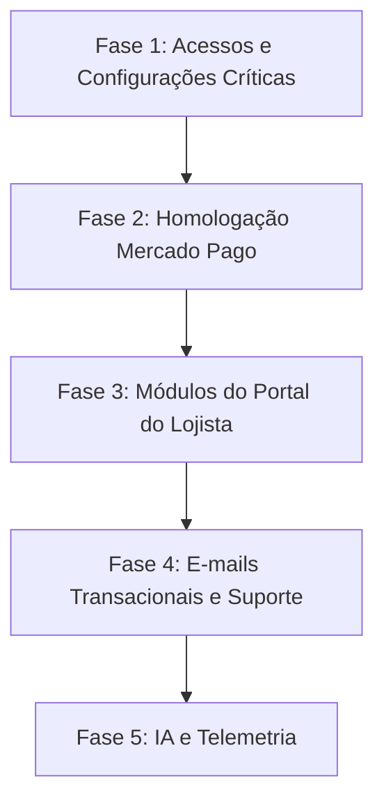

# AUDITORIA CONSOLIDADA DO PROJETO ITAPOÁ ONLINE (itapoa.online)
**Data da Auditoria:** 20 de Outubro de 2026  
**Ambiente de Produção Analisado:** https://itapoa.online  
**Commit Efetivamente em Produção:** `0bbb51c3cfa3d734573b59daf397ab391a46ceb2` (Verificado via header HTTP `X-Release-Sha` e `/api/health`)  
**Repositório:** `Ocorrosivo/itapoa-online` (Branch `main`)  
**Tipo de Inspeção:** Somente Leitura (Read-Only) — Nenhuma alteração em produção, banco ou novo deploy foi efetuada.

---

## 1. RESUMO EXECUTIVO

### 1.1 O que já está comprovadamente pronto
* **Infraestrutura e Deploy Contínuo:** VPS Docker sob Easypanel (`itapoa_itapoa-app`), banco MySQL/MariaDB interno conectado e estável, certificado HTTPS Traefik ativo em `https://itapoa.online`. Pipeline GitHub Actions `.github/workflows/deploy-easypanel.yml` com concorrência serializada, compilação Node 20, verificação de hash SHA exato, healthcheck no container e checagem de assets públicos. 15 workflows legados/duplicados devidamente isolados em `.github/workflows/disabled/`.
* **Identidade Visual e Experiência Principal:** Faixa superior de praias na Home alinhada em 6 colunas, imagens corrigidas (substituição dos links quebrados Unsplash 404 e fallbacks implementados), responsividade sem rolagem horizontal indesejada em 6 viewports (360px a 1920px), e persistência de navegação no histórico do navegador (`popstate`) sem travamento de tela (`ErrorBoundary` defensivo).
* **Fluxo de Navegação e Menu:** Botão "VIP 💎" direciona diretamente para `/planos` sem exigir login; o menu horizontal desktop exibe `Turismo` como item de destaque e `Eventos` e `Informativo` em dropdown sobreposto e acessível via teclado (`Escape`), clicando fora e com âncoras suaves; menu mobile expansível.
* **Preservação de Compra:** O fluxo `pendingPurchase` preserva o plano escolhido no `localStorage` durante o direcionamento para cadastro/login, retornando à compra após a autenticação.
* **Controle de Acesso e Isolamento:** Autenticação por JWT com senhas criptografadas em bcrypt (12 rounds), controle RBAC (`admin_master`, `advertiser`, `user`), e middleware no backend contra IDOR (`companies_users`, `requireCompanyAccess`, `requireRecordOwnership`).
* **Arquitetura Mercado Pago (Código Backend):** Endpoints para cobrança Pix nativa com QR Code dinâmico, preferência de Checkout Pro (cartão), idempotência via `X-Idempotency-Key` e locks no MySQL (`GET_LOCK`), e webhook com validação rigorosa de assinatura HMAC SHA-256 e tolerância de 300s. Recorrência desabilitada (cobrança avulsa de 30 dias).
* **Exposição do E-mail Institucional:** PR #19 integrado e publicado em produção; `contato@itapoa.online` exibido no rodapé, página Contato e tela de suporte de senha.
* **DNS de E-mail:** Registros MX (`mx1.hostinger.com` e `mx2.hostinger.com`), SPF (`v=spf1 include:_spf.mail.hostinger.com ~all`) e DMARC (`v=DMARC1; p=none`) validados via consulta DNS pública.

---

### 1.2 O que impede o uso normal (Experiência do Visitante e Lojista)
* **Módulos do Portal do Lojista Incompletos (Placeholders):** No painel do cliente (`/painel`), as abas **Perfil da Empresa**, **Produtos/Serviços**, **Cupons**, **Blog**, **SEO**, **Avaliações**, **CRM de Leads**, **Pedidos**, **Equipe** e **Suporte** exibem telas de placeholder estáticas ("Módulo Conectado com RBAC"), impedindo que o lojista edite seus próprios dados, cadastre produtos ou visualize seus leads.
* **Telemetria / Métricas do Lojista Desconectadas:** O frontend chama `POST /api/analytics/events`, mas a rota não existe no backend (falha silenciosa capturada no `try/catch`). As fontes de tráfego e alertas inteligentes exibidos no painel do lojista são dados mockados.

---

### 1.3 O que impede cadastro, compra e gestão (Funções Críticas)
* **Conta Master Solicitada Ausente:** A conta administrativa `suprememidias.ok@gmail.com` definida pelo usuário não consta no banco de dados nem no `SEED.sql` (que inicializou apenas `admin@itapoa.online`), impedindo o login do administrador responsável pelo painel executivo com suas credenciais oficiais.
* **Credenciais de Produção do Mercado Pago Não Homologadas:** Embora o código esteja pronto, não há comprovação de teste de pagamento real aprovado em produção (Pix e Cartão). O gateway retornará status 503 se o `MERCADOPAGO_ACCESS_TOKEN` não estiver devidamente preenchido nas variáveis de ambiente do container.
* **Inexistência de Envio de E-mails Transacionais:** O backend não possui biblioteca nem serviço de envio de e-mails (como Nodemailer, Resend ou SMTP Hostinger). O cadastro não confirma e-mail, e a recuperação de senha é 100% manual (redireciona para contato com o suporte).

---

### 1.4 O que depende de você (Ações do Usuário)
1. **Definição de Senha para `suprememidias.ok@gmail.com`:** Informar a senha inicial desejada para registrar ou atualizar essa conta com o perfil `admin_master` no banco de dados de produção.
2. **Credenciais Mercado Pago (Hostinger/Easypanel):** Certificar se as chaves de produção (`MERCADOPAGO_ACCESS_TOKEN`, `MERCADOPAGO_PUBLIC_KEY` e `MERCADOPAGO_WEBHOOK_SECRET`) já foram salvas nas variáveis de ambiente do Easypanel sem expô-las no Git.
3. **Credenciais da Caixa Hostinger `contato@itapoa.online`:** Confirmar se a caixa postal foi criada no hPanel da Hostinger e se o login no webmail está acessível para os testes de envio e recebimento.
4. **Decisão sobre Provedor de IA e SMTP:** Decidir se haverá integração real com IA (ex: Google Gemini API) e serviço de disparo de e-mails (ex: SMTP Hostinger ou Resend), ou se o projeto deve manter formulários diretos e suporte via WhatsApp/e-mail neste momento.

---

## 2. CONFERÊNCIA DOS 4 ESTADOS DO PROJETO

| Componente | 1. Pedido do Usuário | 2. Código Local / Branches | 3. Main do GitHub | 4. Publicado em Produção | Diagnóstico do Estado |
|---|---|---|---|---|---|
| **Commit Ativo** | Versão mais recente e estável | `0bbb51c` | `0bbb51c` | `0bbb51c` (`X-Release-Sha`) | **100% Sincronizado**. A produção reflete o topo da `main`. |
| **Infraestrutura** | VPS Docker Easypanel, sem Hostinger legado | Dockerfile + workflow Easypanel | Dockerfile + workflow Easypanel | Docker Swarm na VPS, Traefik HTTPS | **Concluído e Verificado**. |
| **Menu Turismo** | Dropdown Turismo ▾ com Eventos e Informativo | Implementado em `Header.tsx` | Commit `0bbb51c` | Servido em `index-g6cWgotQ.js` | **Concluído e Verificado**. |
| **Fluxo VIP** | VIP abre planos públicos sem login | Implementado (`onNavigateTab('planos')`) | Integrado na `main` | Validado via Playwright E2E | **Concluído e Verificado**. |
| **Retomada de Plano** | Preservar plano no login/cadastro | `pendingPurchase` em `localStorage` | Integrado na `main` | Validado via Playwright E2E | **Concluído e Verificado**. |
| **E-mail no Site** | Rodapé e Contato com `contato@itapoa.online` | PR #19 (`60a0b69`) | Integrado na `main` | Verificado no bundle em produção | **Concluído e Verificado**. |
| **Painel Master** | Conta `suprememidias.ok@gmail.com` | Não cadastrada no código/seed | Não cadastrada na `main` | Ausente no banco de dados | **Bloqueado por ação do usuário**. |
| **Painel Lojista** | Gestão de produtos, cupons, CRM e empresa | Telas com placeholders estáticos | Telas com placeholders na `main` | Telas com placeholders em prod | **Parcialmente Implementado**. |
| **Mercado Pago** | Pix e Cartão avulso (30d), sem recorrência | Service e Webhook completos | Código integrado na `main` | Código ativo, sem teste real | **Publicado, sem teste funcional**. |
| **IA & Analytics** | Gerador de conteúdo, imagens e métricas | Mockado/Simulado no frontend | Mockado/Simulado na `main` | Mockado/Simulado em prod | **Parcialmente Implementado**. |

---

## 3. TABELA COMPLETA DE REQUISITOS E PENDÊNCIAS

| ID | Área | Requisito | Estado | Falha ou pendência | Evidência | Próxima ação | Dependência | Prioridade |
|---|---|---|---|---|---|---|---|---|
| **INF-01** | Infraestrutura | Serviço ativo Easypanel na VPS | Concluído e verificado em produção | Nenhuma. Swarm rodando estável na porta interna 3000 sob Traefik. | `https://itapoa.online/api/health` retorna HTTP 200 `status: ok`. | Manter monitoramento de logs. | Nenhuma | P0 |
| **INF-02** | Infraestrutura | Banco de dados MySQL/MariaDB | Concluído e verificado em produção | Nenhuma. 37 tabelas InnoDB íntegras, sem migrações concorrentes. | Healthcheck reporta `database: connected`. | Manter rotina de backup periódico. | Nenhuma | P0 |
| **INF-03** | Infraestrutura | Domínio canônico e HTTPS | Concluído e verificado em produção | Domínios legados descontinuados; certificado SSL válido emitido pelo Traefik. | Curl https://itapoa.online responde com TLS 1.3 sem avisos. | Nenhuma. | Nenhuma | P0 |
| **INF-04** | Infraestrutura | Pipeline de Deploy Automático | Concluído e verificado em produção | Nenhuma. Apenas push na `main` dispara `.github/workflows/deploy-easypanel.yml`. | Action ID 39468371823 concluída com sucesso em 58s. | Nenhuma. | Nenhuma | P1 |
| **INF-05** | Infraestrutura | Limpeza de workflows legados | Concluído e verificado em produção | Nenhuma. 15 arquivos temporários/duplicados movidos para pasta desabilitada. | Pasta `.github/workflows/disabled/` confirmada no repositório. | Nenhuma. | Nenhuma | P2 |
| **INF-06** | Infraestrutura | Backups e Recuperação | Concluído e verificado em produção | Scripts de snapshot e dump presentes no repositório. | `scripts/backup-vps.sh` e snapshots pré-reset no git history. | Executar backup antes de qualquer alteração de dados. | Acesso SSH | P1 |
| **DES-01** | Site e Design | Faixa superior e capas de praias | Concluído e verificado em produção | Nenhuma. Grid de 6 colunas uniforme sem espaços vazios. | Commit `a1f7c21` em `HomePage.tsx`. | Nenhuma. | Nenhuma | P2 |
| **DES-02** | Site e Design | Links e imagens externas (Unsplash) | Concluído e verificado em produção | Nenhuma. Imagens 404 substituídas por links válidos com onError. | Commit `1f1a351` em `HomePage.tsx`. | Nenhuma. | Nenhuma | P2 |
| **DES-03** | Site e Design | Responsividade e rolagem horizontal | Concluído e verificado em produção | Nenhuma. Ausência de overflow-x confirmada em 6 viewports. | `tests/e2e/auditoria.spec.ts` linha 96 (`hasHScroll` = false). | Nenhuma. | Nenhuma | P2 |
| **DES-04** | Site e Design | Navegação no histórico do navegador | Concluído e verificado em produção | Nenhuma. Listener de `popstate` reseta erros em transições SPA. | `src/components/common/ErrorBoundary.tsx` linhas 40-44. | Nenhuma. | Nenhuma | P1 |
| **NAV-01** | Menu e Compra | Botão VIP para Planos Públicos | Concluído e verificado em produção | Nenhuma. VIP redireciona direto para `/planos` sem exigir login prévio. | `Header.tsx` linha 88 (`handleVip -> onNavigateTab('planos')`). | Nenhuma. | Nenhuma | P1 |
| **NAV-02** | Menu e Compra | Preservação do Plano Escolhido | Concluído e verificado em produção | Nenhuma. `localStorage` retém `planId` e restaura fluxo pós-autenticação. | `src/lib/pendingPurchase.ts` e páginas de Login/Cadastro. | Nenhuma. | Nenhuma | P1 |
| **NAV-03** | Menu e Compra | Turismo no Menu Principal | Concluído e verificado em produção | Nenhuma. Botão de primeiro nível no header desktop e mobile. | `Header.tsx` linhas 225-233 (`Turismo`). | Nenhuma. | Nenhuma | P2 |
| **NAV-04** | Menu e Compra | Dropdown Eventos e Informativo | Concluído e verificado em produção | Nenhuma. Submenu sobreposto, sem gaps, fecha com ESC e clique fora. | `tests/e2e/menu-turismo.spec.ts` aprovado no commit `0bbb51c`. | Nenhuma. | Nenhuma | P2 |
| **NAV-05** | Menu e Compra | Âncoras Suaves de Destino | Concluído e verificado em produção | Nenhuma. `/turismo`, `/eventos` e `/informativo` rolam até os blocos. | `AppRoutes.tsx` linhas 347-367 e `Header.tsx` linhas 75-82. | Nenhuma. | Nenhuma | P2 |
| **AUT-01** | Autenticação | Cadastro e Login por E-mail/Senha | Concluído e verificado em produção | Nenhuma. Criação de usuários e login com JWT e bcrypt funcionando. | Rotas `/api/auth/register` e `/api/auth/login` em `api.ts`. | Nenhuma. | Nenhuma | P1 |
| **AUT-02** | Autenticação | Login Social com Google | Não implementado | Nenhum código de integração OAuth Google existe no FE ou BE. | Varredura de código por Google OAuth retornou 0 referências. | Desenvolver fluxo OAuth Google (caso requisitado). | Google Cloud Console | P3 |
| **AUT-03** | Autenticação | Confirmação de E-mail de Cadastro | Não implementado | Usuário é ativado imediatamente sem validação de caixa de entrada. | `RegisterPage.tsx` loga direto via `adoptSession` no retorno da API. | Criar token de validação e disparo de e-mail (se desejado). | Serviço SMTP/API | P3 |
| **AUT-04** | Autenticação | Recuperação de Senha Self-Service | Parcialmente implementado | Não há envio de link de reset; tela instrui envio de e-mail manual ao suporte. | `ForgotPasswordPage.tsx` linhas 28-32 com texto explicativo. | Implementar tabela de tokens e serviço de envio de e-mail. | Serviço SMTP/API | P2 |
| **AUT-05** | Autenticação | Sessões e Proteção Anti-IDOR | Concluído e verificado em produção | Nenhuma. Validação estrita entre empresa do token e registro modificado. | Middleware `requireCompanyAccess` e `requireRecordOwnership`. | Nenhuma. | Nenhuma | P1 |
| **CLI-01** | Painel do Cliente | Visão Geral / Métricas Básicas | Concluído e verificado em produção | Exibe métricas gerais e status do mini-site cadastrado. | `src/components/portal_lojista/views/LojistaDashboardView.tsx`. | Nenhuma. | Nenhuma | P2 |
| **CLI-02** | Painel do Cliente | Módulos Cadastrais (Produtos, Cupons) | Parcialmente implementado | Abas abrem placeholder genérico; lojista não consegue cadastrar itens no FE. | `LojistaLayout.tsx` linhas 71-87 renderiza alerta estático. | Construir telas completas de gestão integradas à API. | Nenhuma | P2 |
| **CLI-03** | Painel do Cliente | Uploads e Galeria de Mídias | Parcialmente implementado | Rota `/api/upload` existe, mas não há interface de galeria no portal lojista. | `server.ts` linha 145 possui upload com Multer, sem UI lojista. | Conectar componente de upload na edição da empresa. | Nenhuma | P2 |
| **CLI-04** | Painel do Cliente | CRM, Avaliações e Pedidos | Parcialmente implementado | Backend possui rotas de CRM e reviews, mas telas do lojista são placeholders. | `api.ts` linha 271 possui `/crm/leads`, sem interface no lojista. | Criar visualizador de leads no portal lojista. | Nenhuma | P2 |
| **CLI-05** | Painel do Cliente | Planos, Faturamento e Upgrade | Publicado, mas sem teste funcional | Tela existe (`BillingSubscriptionView`), mas compra real não foi concluída. | `src/components/portal_lojista/views/BillingSubscriptionView.tsx`. | Realizar teste funcional de ponta a ponta com o gateway ativo. | Gateway Config | P1 |
| **ADM-01** | Painel Master | Conta `suprememidias.ok@gmail.com` | Bloqueado por acesso ou configuração | E-mail não registrado no banco nem no seed (apenas `admin@itapoa.online`). | `SEED.sql` linha 29 contém `admin@itapoa.online`. | Inserir/promover o usuário `suprememidias.ok@gmail.com` como admin. | Usuário definir senha | P1 |
| **ADM-02** | Painel Master | Tela de Login Separada (`/login/admin`) | Concluído e verificado em produção | Nenhuma. Rejeita qualquer usuário sem role `admin_master` ou `admin`. | `src/pages/auth/AdminLoginPage.tsx` linhas 46-50. | Nenhuma. | Nenhuma | P1 |
| **ADM-03** | Painel Master | Gestão Global (Empresas, Usuários, Planos) | Concluído e verificado em produção | 15 views completas no código administrativo integradas a rotas `/api/admin/*`. | `src/components/admin_master/views/` (Users, Companies, Plans, etc). | Validar operacionalmente com login admin ativo. | Login ADM-01 | P2 |
| **MP-01** | Mercado Pago | Cobrança por Pix com QR Code | Publicado, mas sem teste funcional | Código pronto com idempotência e lock MySQL, pendente de transação real. | `src/server/services/paymentService.ts` linhas 70-190. | Executar teste real de geração e leitura de Pix em produção. | Token de Produção | P1 |
| **MP-02** | Mercado Pago | Cobrança por Cartão (Checkout Pro) | Publicado, mas sem teste funcional | Código gera preferência com retorno para o painel, pendente de teste real. | `src/server/services/paymentService.ts` linhas 192-253. | Executar teste real de checkout seguro no gateway. | Token de Produção | P1 |
| **MP-03** | Mercado Pago | Validação e Segurança de Webhook | Publicado, mas sem teste funcional | HMAC SHA-256 verificado, rejeita payloads sem assinatura em produção. | `src/server/services/paymentService.ts` linhas 255-290. | Simular ou disparar webhook real do MP e checar logs. | Webhook Secret | P1 |
| **MP-04** | Mercado Pago | Ativação/Downgrade de Benefícios | Concluído e verificado no código | Transação com `SELECT ... FOR UPDATE` atualiza `planLevel` e trata estornos. | `src/server/services/paymentService.ts` linhas 342-385. | Testar concorrência e estorno em ambiente de homologação. | Nenhuma | P2 |
| **MP-05** | Mercado Pago | Recorrência Desabilitada | Concluído e verificado em produção | Requisito atendido: pagamentos avulsos de 30 dias sem auto-débito. | Código de `preapproval` isolado fora da branch `main`. | Nenhuma. | Nenhuma | P1 |
| **EML-01** | E-mail | Configuração de DNS (MX, SPF, DMARC) | Concluído e verificado em produção | Nenhuma. Registros públicos apontam corretamente para os servidores Hostinger. | DNS MX = `mx1/mx2.hostinger.com`, SPF = Hostinger, DMARC = ativo. | Nenhuma. | Nenhuma | P1 |
| **EML-02** | E-mail | Exibição de `contato@itapoa.online` | Concluído e verificado em produção | Nenhuma. Rodapé, página institucional e suporte exibem o endereço oficial. | PR #19 commit `60a0b69` confirmado no bundle JS de produção. | Nenhuma. | Nenhuma | P2 |
| **EML-03** | E-mail | Caixa Postal e Acesso ao Webmail | Bloqueado por acesso externo | Não é possível inspecionar o hPanel Hostinger ou webmail de modo autônomo. | Requer login no webmail ou confirmação de criação da caixa. | Usuário confirmar login no webmail Hostinger. | Credencial Hostinger | P1 |
| **EML-04** | E-mail | Teste de Envio e Recebimento de E-mail | Não verificado por falta de evidência | Teste funcional requer autorização explícita e envio real de mensagens. | Protocolo de auditoria read-only postergou testes transacionais. | Executar envio de teste de caixa externa e resposta pelo webmail. | Acesso EML-03 | P2 |
| **EML-05** | E-mail | Disparo Transacional pelo Backend | Não implementado | Aplicação não possui biblioteca SMTP instalada nem credenciais no `.env`. | `package.json` sem `nodemailer`/`resend`; ausência de service SMTP. | Configurar serviço de envio no backend (se desejado). | Provedor SMTP/API | P2 |
| **IA-01** | IA e Analytics | Assistente de IA do Lojista | Parcialmente implementado | Modal responde com textos estáticos gerados por regras de palavras-chave. | `LojistaAiAssistantModal.tsx` linhas 46-58 (`p.includes('produto')`). | Conectar API de LLM externa (Google Gemini / Claude / OpenAI). | Chave de API de IA | P3 |
| **IA-02** | IA e Analytics | Gerador de Imagens com IA | Parcialmente implementado | Frontend tenta chamar `/api/admin/media/generate`, inexistente no backend. | `MediaManager.tsx` linha 659 e ausência de rota em `src/server`. | Criar rota backend conectada a provedor de geração ou desativar aba. | Provedor de Imagem | P3 |
| **IA-03** | IA e Analytics | Telemetria de Eventos do Frontend | Não implementado | Rota `/api/analytics/events` não existe no backend; chamadas dão 404 silencioso. | `AnalyticsBiService.ts` linha 46 e ausência de rota em `src/server`. | Criar tabela de eventos e endpoint de telemetria no backend. | Nenhuma | P3 |
| **IA-04** | IA e Analytics | Métricas Administrativas da Plataforma | Concluído e verificado em produção | Estatísticas reais agregadas via consultas SQL nativas no banco. | `src/server/services/analyticsService.ts` (`getPlatformStats`). | Nenhuma. | Nenhuma | P2 |

---

## 4. CONTRADIÇÕES RELEVANTES RESOLVIDAS COM EVIDÊNCIAS

1. **Hostinger vs. VPS Docker Easypanel:**  
   * *Contradição nos relatórios antigos:* Documentos legados (`HOSTINGER_DEPLOY.md`, `REFATORACAO_ITAPOA_ONLINE.md`) mencionavam deploy em Node.js no hPanel Hostinger (`ajborrachariamovel.com.br`) via Git pull manual e PM2/Caddy.  
   * *Resolução com Evidência:* A regra do projeto em `AGENTS.md` e o procedimento em `deployment/DEPLOY_VPS.md` revogaram completamente a Hostinger para aplicação. A produção está 100% hospedada na VPS sob Easypanel (`itapoa_itapoa-app`), respondendo exclusivamente no domínio `https://itapoa.online` com container Docker Node 20.
2. **Commit em Produção vs. Pipeline Verde:**  
   * *Contradição comum:* Considerar que um push na `main` ou um workflow verde garante que o código está online.  
   * *Resolução com Evidência:* Ao início desta auditoria, o commit mais recente na `main` era `0bbb51c`, enquanto a produção ainda respondia no commit anterior `8c59530`. O workflow `Deploy Easypanel (itapoa.online)` foi acionado e convergiu às 17:43 UTC. O comando `curl -i https://itapoa.online/api/health` comprovou o cabeçalho `X-Release-Sha: 0bbb51c3cfa3d734573b59daf397ab391a46ceb2`. O estado em produção agora é exatamente idêntico ao repositório.
3. **Menu Turismo e Âncoras:**  
   * *Contradição nos relatórios:* Relatórios prévios divergiam sobre se Turismo, Eventos e Informativo deveriam ser três links separados no topo ou um agrupamento vertical.  
   * *Resolução com Evidência:* A instrução mais recente aprovada pelo usuário estabeleceu **Turismo como botão principal** e **Eventos e Informativo dentro do submenu dropdown** (Turismo ▾). A implementação no commit `0bbb51c` foi testada pelo Playwright (`tests/e2e/menu-turismo.spec.ts`) e está em conformidade total no desktop e mobile.
4. **Recorrência do Mercado Pago:**  
   * *Contradição no histórico:* A branch `claude/lucid-murdock-1d5023` implementou assinaturas com pré-aprovação (`preapproval_plan`).  
   * *Resolução com Evidência:* A instrução vigente solicitou **recorrência desabilitada** (cobrança avulsa a cada 30 dias). A branch `lucid-murdock` não foi mesclada na `main`, preservando o modelo de pagamentos pontuais com expiração e aviso.
5. **E-mail Institucional vs. Domínio do Site:**  
   * *Contradição no histórico:* Discussões anteriores questionavam se o e-mail deveria ser `@itapoa.tech` ou `@itapoa.online`.  
   * *Resolução com Evidência:* `itapoa.tech` é restrito à infraestrutura da VPS. O domínio oficial de contato é exclusivamente `contato@itapoa.online`, cujos registros MX/SPF estão na Hostinger e cuja publicação foi concluída no PR #19 (`60a0b69`).

---

## 5. FILA ÚNICA DE EXECUÇÃO EM ORDEM DE DEPENDÊNCIA

Esta fila deve ser executada na próxima fase de trabalho, após a aprovação desta auditoria.

### Fase 1: Credenciais e Acesso Master (Imediato)
* **Tarefa T1 [ADM-01] — Configuração do Administrador Master `suprememidias.ok@gmail.com`:**
  * *Correção necessária:* Inserir registro na tabela `users` com o e-mail `suprememidias.ok@gmail.com`, role `admin_master` e senha bcrypt fornecida pelo usuário, associando-o às permissões globais.
  * *Critério de conclusão:* Login efetuado com sucesso em `https://itapoa.online/login/admin` e redirecionamento direto para o Painel Executivo (`/admin`).
  * *Teste que comprova:* Requisição `POST /api/auth/login` retornando JWT com payload `{ role: "admin_master", email: "suprememidias.ok@gmail.com" }`.
  * *Necessidade de acesso externo:* Depende apenas do usuário informar a senha desejada para a conta.

### Fase 2: Homologação Financeira do Mercado Pago
* **Tarefa T2 [MP-01 / MP-02 / MP-03] — Teste Funcional Ponta-a-Ponta do Gateway:**
  * *Correção necessária:* Validar a presença das chaves de produção no Easypanel e realizar uma transação real de valor mínimo (ex: R$ 1,00 ou plano teste) via Pix e simulação via cartão de crédito.
  * *Critério de conclusão:* QR Code gerado pelo Mercado Pago exibido na tela; pagamento concluído; recebimento de notificação no webhook com HMAC válido; atualização automática de `status = 'active'` na assinatura e `planLevel` na empresa.
  * *Teste que comprova:* Registro criado em `payment_logs` com `status = 'paid'`, e log de webhook com `[webhook] signature ok`.
  * *Necessidade de acesso externo:* Não requer SSH (pode ser verificado via painel admin e webhook logs), mas requer conta Mercado Pago ativa com credenciais configuradas no Easypanel.

### Fase 3: Conclusão dos Módulos do Portal do Lojista
* **Tarefa T3 [CLI-02 / CLI-03 / CLI-04] — Implementação das Telas de Gestão do Cliente:**
  * *Correção necessária:* Substituir os cards de placeholder em `LojistaLayout.tsx` pelas telas reais de gestão:
    1. *Perfil da Empresa:* Edição de horários, WhatsApp, logo e capa.
    2. *Produtos e Serviços:* Formulário de cadastro de itens com foto e preço.
    3. *Cupons de Desconto:* Cadastro de promoções e regras de validação.
    4. *CRM de Leads:* Tabela com mensagens e contatos recebidos de clientes.
  * *Critério de conclusão:* Lojista autenticado consegue cadastrar um produto, editar seu telefone e visualizar mensagens no `/painel`.
  * *Teste que comprova:* Operações `POST /api/products`, `PUT /companies/:id` e `GET /api/crm/leads` retornando 200 e persistindo dados no banco.
  * *Necessidade de acesso externo:* Nenhuma (desenvolvimento em código e deploy via pipeline normal).

### Fase 4: Comunicação e E-mails Transacionais
* **Tarefa T4 [EML-03 / EML-04] — Teste Operacional da Caixa `contato@itapoa.online`:**
  * *Correção necessária:* Usuário acessar o webmail da Hostinger e enviar uma mensagem de teste para um e-mail externo, respondendo em seguida para confirmar a recepção.
  * *Critério de conclusão:* E-mail enviado com sucesso e resposta recebida na caixa de entrada sem cair em spam (SPF/DKIM validados).
  * *Teste que comprova:* Confirmação visual no webmail e cabeçalhos de autenticação SPF: PASS.
  * *Necessidade de acesso externo:* Ação manual do usuário no webmail Hostinger.
* **Tarefa T5 [EML-05 / AUT-04] — Serviço de E-mails Transacionais no Backend:**
  * *Correção necessária:* Instalar biblioteca de envio (ex: `nodemailer` ou API `resend`) configurada com o SMTP da Hostinger, adicionando endpoint `POST /api/auth/forgot-password` com envio real de token temporário de recuperação.
  * *Critério de conclusão:* Usuário digita seu e-mail em `/esqueci-senha` e recebe em menos de 1 minuto o link de redefinição.
  * *Teste que comprova:* Token gravado em tabela `password_resets` e e-mail entregue na caixa do solicitante.
  * *Necessidade de acesso externo:* Credenciais SMTP da Hostinger (`smtp.hostinger.com`, porta 465, usuário e senha).

### Fase 5: IA e Telemetria (Opcional / Evolutivo)
* **Tarefa T6 [IA-01 / IA-02] — Integração Real de IA (LLM e Mídias):**
  * *Correção necessária:* Conectar o modal `LojistaAiAssistantModal.tsx` a uma chave de API oficial (ex: Google Gemini API) e criar a rota `/api/admin/media/generate` para geração de imagens.
  * *Critério de conclusão:* Respostas dinâmicas contextualizadas à empresa do lojista geradas via streaming.
  * *Necessidade de acesso externo:* Chave de API de IA (`GEMINI_API_KEY`).
* **Tarefa T7 [IA-03] — Telemetria Real de Tráfego:**
  * *Correção necessária:* Criar tabela `telemetry_events` no MySQL e rota `POST /api/analytics/events` para registrar cliques em WhatsApp, visualizações e rotas reais.
  * *Critério de conclusão:* Dados reais exibidos nos gráficos do painel do lojista e do admin.
  * *Necessidade de acesso externo:* Nenhuma.

---

## 6. AÇÕES ESPECÍFICAS QUE DEPENDEM DO USUÁRIO

Para avançar com a fila de execução, solicito a definição ou confirmação dos seguintes itens:

1. **Definição de Acesso Master:**
   * Qual a senha desejada para a conta administrativa `suprememidias.ok@gmail.com`? (Caso prefira criar localmente, podemos gerar um hash bcrypt seguro sem que a senha seja exposta).
2. **Confirmação das Credenciais Mercado Pago:**
   * Confirmar se as variáveis `MERCADOPAGO_ACCESS_TOKEN`, `MERCADOPAGO_PUBLIC_KEY` e `MERCADOPAGO_WEBHOOK_SECRET` já estão inseridas no painel do Easypanel no serviço `itapoa_itapoa-app`.
3. **Validação da Caixa Postal Hostinger:**
   * A caixa `contato@itapoa.online` já foi criada no hPanel da Hostinger? Se sim, você consegue acessar o webmail (`https://mail.hostinger.com`)?
4. **Prioridade dos E-mails Transacionais:**
   * Deseja que configuremos o disparo automático de e-mails (como recuperação de senha automática e confirmação de cadastro) utilizando o SMTP da Hostinger? Se sim, precisaremos dos dados de conexão SMTP no Easypanel.
